# JOMO Keymap

## Leader sequences

Tap the outer right thumb, then type the sequence.

| Sequence | Action                                      |
| -------- | ------------------------------------------- |
| `C I`    | Clock in (Trackit picker, F17)              |
| `C O`    | Clock out (Trackit, F18)                    |
| `A T`    | Add a todo (Trackit, F19)                   |
| `S C`    | Screenshot a region to the clipboard (⌃⇧⌘4) |
| `S S`    | Screenshot a region to a file (⇧⌘4)         |
